# MHGU Save Editor

A desktop save editor for **Monster Hunter Generations Ultimate** (Nintendo Switch,
emulator saves and console backups).

<a href="docs/screenshots/README.md#overview"><picture><source media="(prefers-color-scheme: dark)" srcset="docs/screenshots/01-overview-dark.png">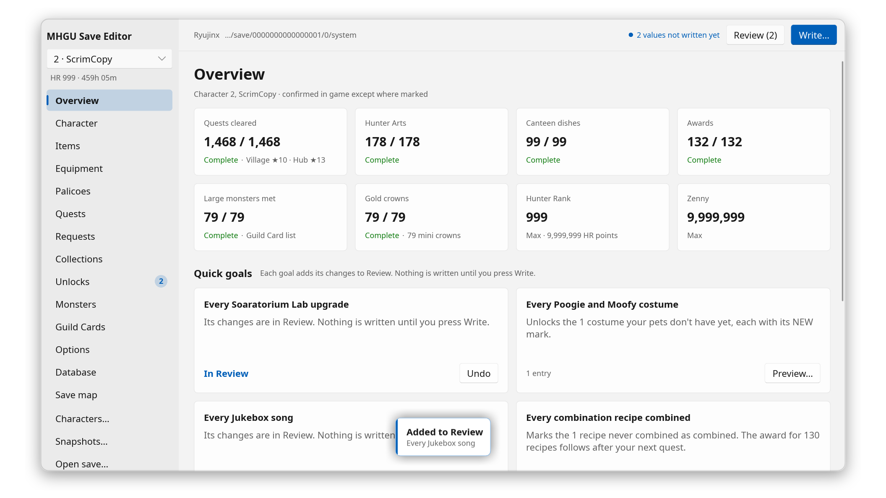</picture></a>

Click a screenshot to see it at full size (1920×1080 at 1x scale).

Every value it shows is read where the game itself keeps it, and every change is
described in game terms ("Mega Potion ×10", "HR 999", "every quest cleared") before
anything touches the file. Every edit has been checked in game (**Confirmed**), but for
the few the Switch game can't show ([listed below](#what-it-edits)); an edit added later
that has not been checked yet is marked **Derived** until it is.

## Download

Get the latest file from the [releases](https://github.com/Scrimas/MHGU-Save-editor/releases):

| File | Runs on |
|---|---|
| `MHGU-Save-Editor-<version>-x86_64.exe` | Windows 10 / 11, nothing to install |
| `MHGU-Save-Editor-<version>-x86_64.AppImage` | Linux x86-64 (distros from 2019 on) |

The `.exe` is not code-signed, so Windows SmartScreen warns the first time: **More info → Run anyway**.
The AppImage adds itself to the application menu when started.

The editor checks for a newer version when it starts and asks before downloading it
(Settings → Updates turns this off).

Version numbers: the first number goes up once every edit has been checked in game, so a
release *N*.0.0 has no Derived edit; the second adds features, whose new edits may be
Derived; the third fixes bugs.

## Opening your save

Saves are found automatically for **Ryujinx** and for **yuzu** and its forks (suyu,
Sudachi, Citron, Eden, torzu), Flatpak installs included. For a portable install or
another emulator, add its folder in **Settings…** or use **Open save…** on its `system`
file (title ID `0100770008DD8000`, EU / western release). On Windows you can also drag
the file onto the window.

**From a real Switch**: back the save up with JKSV or Checkpoint, open the `system` file of
the backup folder on the SD card (found automatically while the card is mounted), write,
then restore the backup on the console with the same tool. A JKSV ZIP backup has to be
extracted first.

## What it edits

| Page | |
|---|---|
| Overview | One-click goals: complete every quest, all Hunter Arts, Canteen dishes and ingredients, all Guild Card awards, Hunter's Notes, every crown, HR 999, max zenny and points, every item obtained, every Smithy entry listed, every Guild Card title word, scene and pose, every Soaratorium Lab upgrade, Poogie and Moofy costume, Jukebox song, combination recipe and Gallery movie |
| Character | Name, Hunter Rank and HR points, zenny, Wycademy points, Village and Hub star levels, play time, appearance: body type, face, hairstyle, voice, features, clothing, skin and clothing colours; Guild Card title, scene, pose and greeting, Guild Card weapon usage, quests completed per hunting style; the hunting style, Hunter Arts (SP too) and armor pigment you have on, the Courier's quest counter and points, the village a load starts in and the Room Service's Housekeeper (only those the game offers) |
| Items | Item box, pouch and loadouts (name and pouch layout); add, sort and merge, max counts; the item box exported to and imported from a CSV file (slot, ID, name, count). A pouch stack above the item's carry limit is written with a warning |
| Equipment | Hunter and Palico equipment boxes: add, replace and remove pieces, levels, decorations (those that do not fit the free slots with a warning), transmog, talismans (checked against the game's charm tables); each box exported to and imported from a CSV file (entries worn or in a set stay); talismans copied as text in the charm list format of Athena's Armor Set Search, and pasted in to add; My Sets: name, gear, pigment, hunting style and Hunter Arts (checked against the weapon, the style's slots and the arts unlocked), a set made from what you have on; Palico equipment sets: name and gear |
| Palicoes | Name, level and experience, forte, target, greeting, original owner; support moves and skills: the list and what is equipped, checked against the forte's innate entries and the level's slots; looks: coat, eyes, ears, tail, voice, clothing and their colours from the game's palettes; a Palico copied with the equipment it wears to another character, or exported to a file and imported into any save; the Palicoes for hire (same editor); the Palico played as Prowler and the two hunting buddies, Palicoes hired and (Derived) Dojo sessions completed; the Palico Scout's conditions; StreetPass Palicoes (remove from the inbox, Derived); the Dojo, Palico Board and Meownster Hunters read-only |
| Quests | Every quest cleared or not (seen and quest sets follow, as in game, and so do the Guild Card's quests-completed counts); says what unlocks a quest that is not on the board yet. Arena records: best time and equipment set per Arena quest, ranked by the quest's times. History: the Guild Card's last ten records (date, result, quest, party), read-only |
| Requests | Villager requests: accepted (quest posted on the board) and reported |
| Collections | Hunter Arts, Canteen dishes and ingredients, Guild Card awards, Deviants (Special Permits and levels cleared; says when G-rank levels still wait for a G-rank hunt; Special Permit points and those waiting at the Courier) |
| Unlocks | Entry by entry, each with what unlocks it in game: Soaratorium Lab upgrades (the supply drop sets follow), Jukebox songs, Poogie and Moofy costumes; the village pets (names, costumes worn, adoption), Moofah affection and Moofah gifts (with their award); the Housekeeper's Gallery, tips read, the Combination List recipes combined, one-time event scenes and (Derived) the milestones the award checks read. Shown read-only, as the game fills them itself whatever the save holds: the supply drop sets, Horns Coin trades, what the Trader sells, the Hunter's Notes second list, and the Market, Guild Store and Armory lists |
| Monsters | Hunted and captured counts, smallest and largest sizes (checked against the sizes the game's quests give), Hunter's Notes |
| Guild Cards | The Guild Cards stored (HR, type, Unity, title, weapon, greeting) and the Guild Card Inbox: remove a card (Derived for the inbox), move an inbox card to the Card List as the Post Office does; the blocked-user list (unblock, Derived); the Hunters for Hire offered and hired, read-only |
| Options | The Start Menu's Options and Multiplayer Settings, the shoutouts and auto-shoutouts of the three chat groups and the group in use; the title screen's TV brightness, rumble and language (shared by the characters) |
| Database | The game's own data next to the save, read-only: monsters, quests, items, skills and equipment ([below](#database)) |
| Save map | Every byte range of the save, named from the game's own loader (read-only) |

All three character slots are supported. **Characters…** copies, swaps and deletes whole
characters, and exports one to a file to import it into a slot of any save. It also moves
characters to and from **MHXX** saves (3DS, or the Japanese Switch release; Derived).

**Still Derived**, because the Switch game can't show them: removing a StreetPass Palico
or an inbox Guild Card (MHGU on Switch has no StreetPass), unblocking a hunter (the list
only opens online), the milestones (every award they feed was already held in the checked
save), the Dojo sessions count (no session finished in a checked save), the MHXX moves
(they need a 3DS), and the Database's crown chances.

**Values the game cannot produce** (a stack above its limit, a decoration that does not
fit, a talisman outside the charm tables, a weapon above its top level, a locked Guild
Card title…) are never refused: they are written as they are, with a warning next to the
value and in Review and Write. They work offline; online, other hunters can see them.

<table>
  <tr>
    <td width="50%">
      <a href="docs/screenshots/README.md#character"><picture><source media="(prefers-color-scheme: dark)" srcset="docs/screenshots/11-character-dark.png">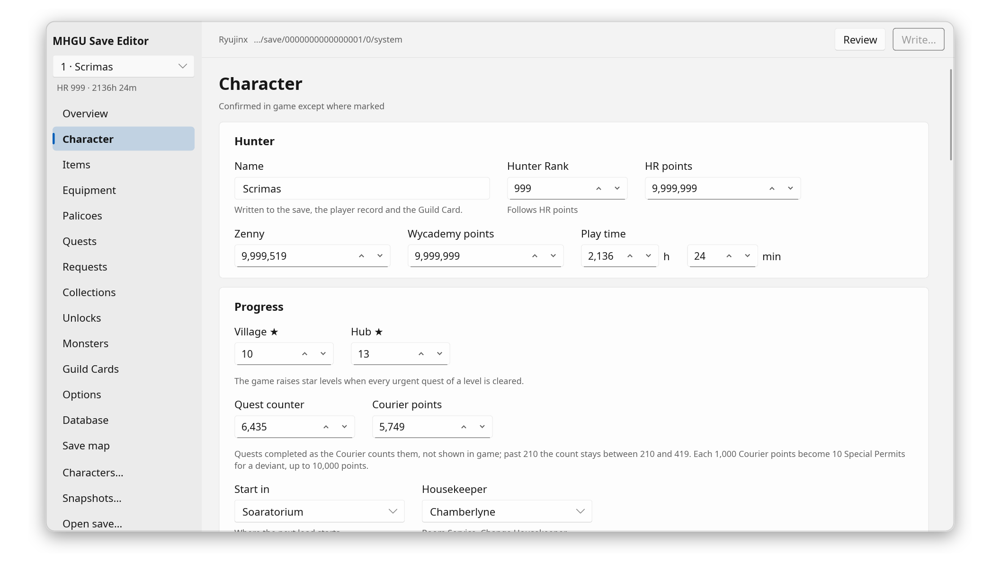</picture></a>
    </td>
    <td width="50%">
      <a href="docs/screenshots/README.md#palicoes"><picture><source media="(prefers-color-scheme: dark)" srcset="docs/screenshots/12-palicoes-dark.png">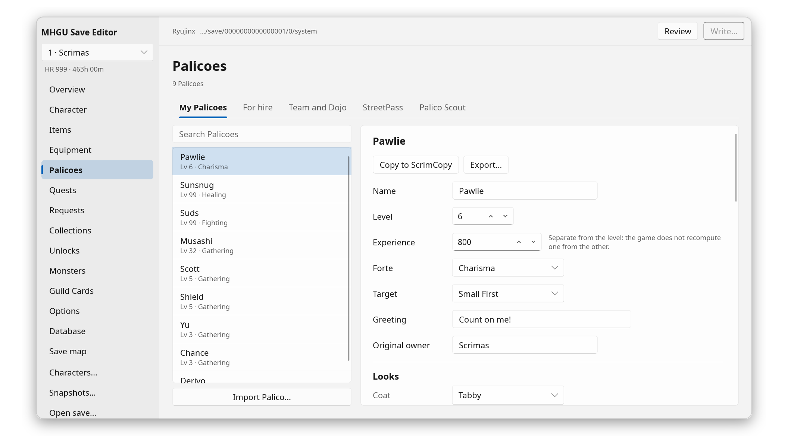</picture></a>
    </td>
  </tr>
  <tr>
    <td align="center">Character</td>
    <td align="center">Palicoes</td>
  </tr>
  <tr>
    <td>
      <a href="docs/screenshots/README.md#items"><picture><source media="(prefers-color-scheme: dark)" srcset="docs/screenshots/02-items-dark.png">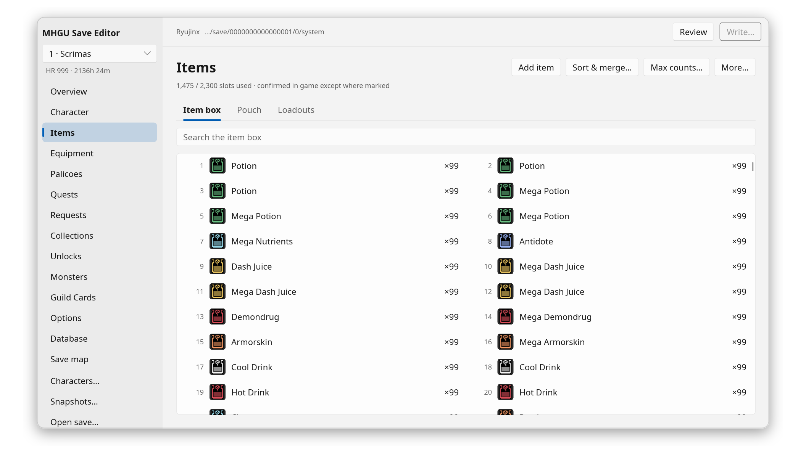</picture></a>
    </td>
    <td>
      <a href="docs/screenshots/README.md#equipment"><picture><source media="(prefers-color-scheme: dark)" srcset="docs/screenshots/03-equipment-dark.png">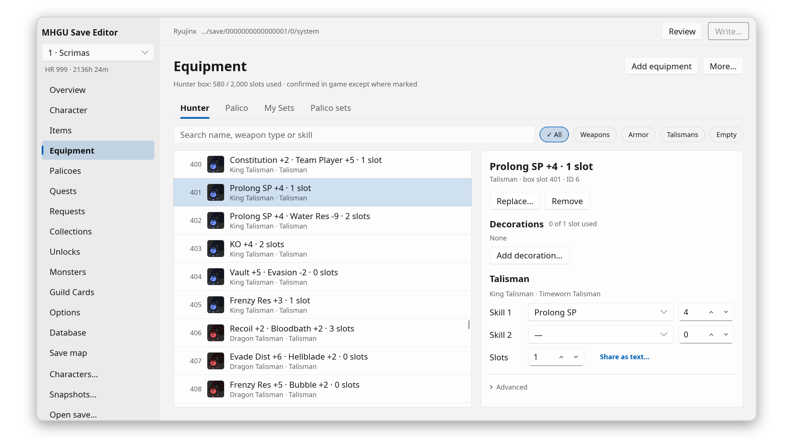</picture></a>
    </td>
  </tr>
  <tr>
    <td align="center">Items</td>
    <td align="center">Equipment</td>
  </tr>
  <tr>
    <td>
      <a href="docs/screenshots/README.md#monsters"><picture><source media="(prefers-color-scheme: dark)" srcset="docs/screenshots/04-monsters-dark.png">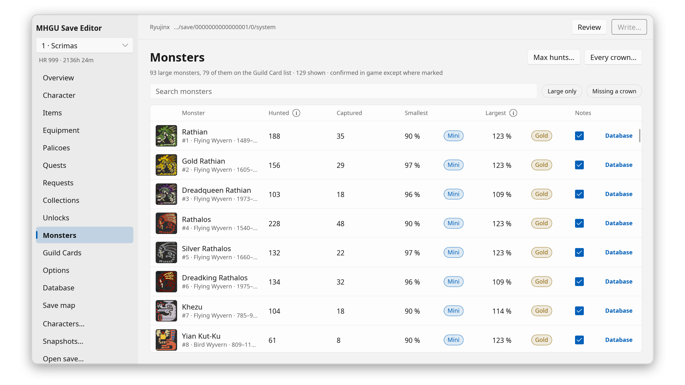</picture></a>
    </td>
    <td>
      <a href="docs/screenshots/README.md#quests"><picture><source media="(prefers-color-scheme: dark)" srcset="docs/screenshots/05-quests-dark.png">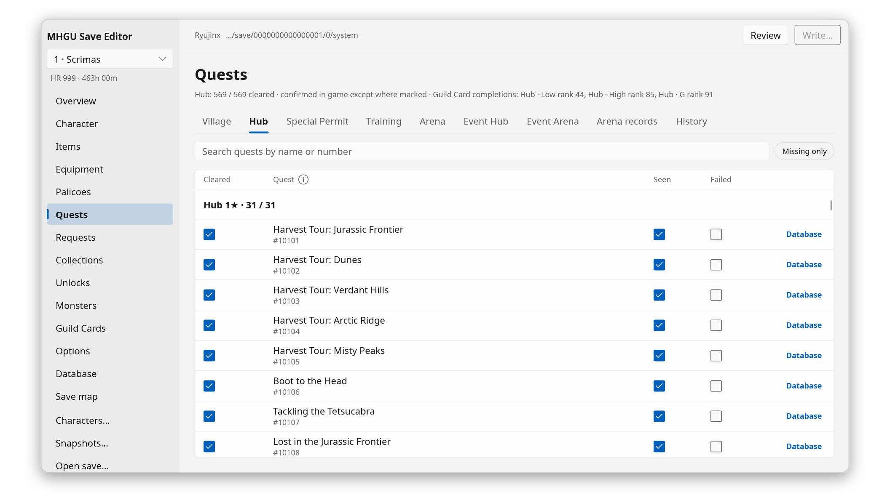</picture></a>
    </td>
  </tr>
  <tr>
    <td align="center">Monsters</td>
    <td align="center">Quests</td>
  </tr>
  <tr>
    <td>
      <a href="docs/screenshots/README.md#collections-deviants"><picture><source media="(prefers-color-scheme: dark)" srcset="docs/screenshots/13-collections-dark.png">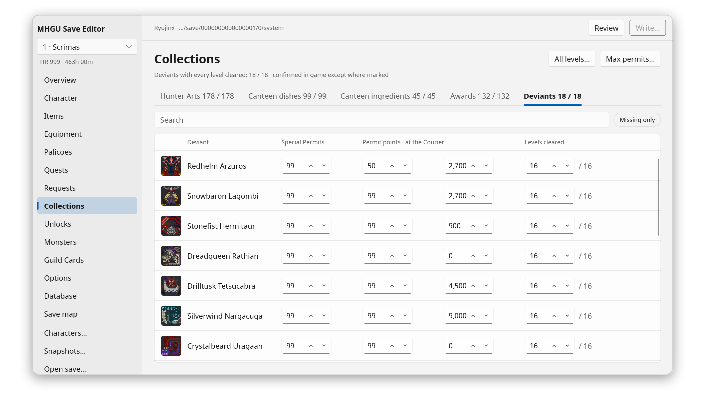</picture></a>
    </td>
    <td>
      <a href="docs/screenshots/README.md#unlocks"><picture><source media="(prefers-color-scheme: dark)" srcset="docs/screenshots/15-unlocks-dark.png">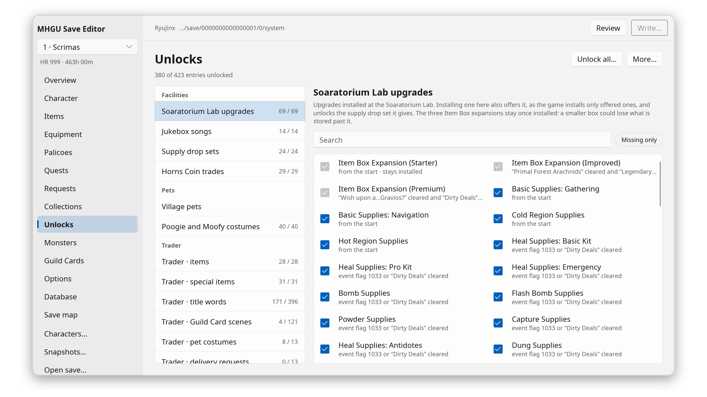</picture></a>
    </td>
  </tr>
  <tr>
    <td align="center">Collections: deviants</td>
    <td align="center">Unlocks</td>
  </tr>
</table>

## Database

The **Database** page puts the game's own tables next to your save, so you can see what is
left to get and where to get it. Nothing on it is edited; its links lead to the page that
edits the value.

- **Monsters**: your size record against the mini and gold crown sizes; the chance of a
  crown in each quest, best first (Derived); carves per rank, with what your box holds.
- **Quests**: what the quest board shows, the monsters with their sizes and crown chances
  (Derived), and the reward tables.
- **Items**: every carve, quest reward and combination that gives the item, with its chance;
  every Smithy recipe and combination that takes it.
- **Skills**: what a skill tree activates, and the decorations, talismans and armor that
  give its points ("Razor Sharp", "Razor Jwl 3" and "Sharpness" all find it).
- **Equipment**: what forging, upgrading and each level take against your item box, and
  the weapon's upgrade tree.

<a href="docs/screenshots/README.md#database-monster"><picture><source media="(prefers-color-scheme: dark)" srcset="docs/screenshots/08-database-monster-dark.png">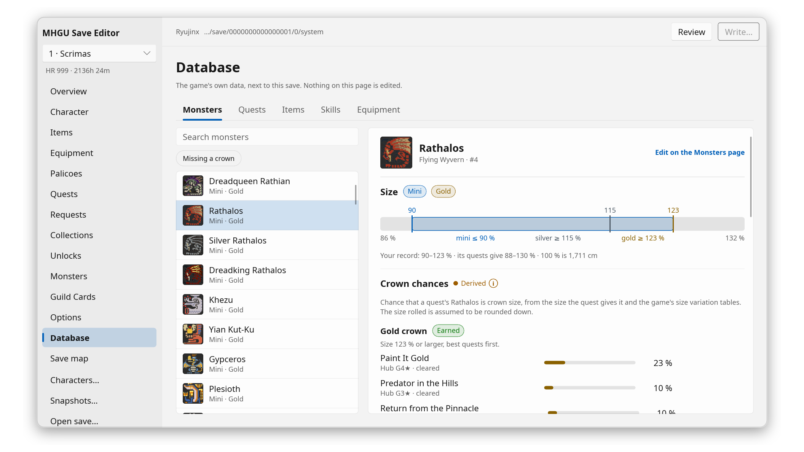</picture></a>

<table>
  <tr>
    <td width="50%">
      <a href="docs/screenshots/README.md#database-item"><picture><source media="(prefers-color-scheme: dark)" srcset="docs/screenshots/09-database-item-dark.png">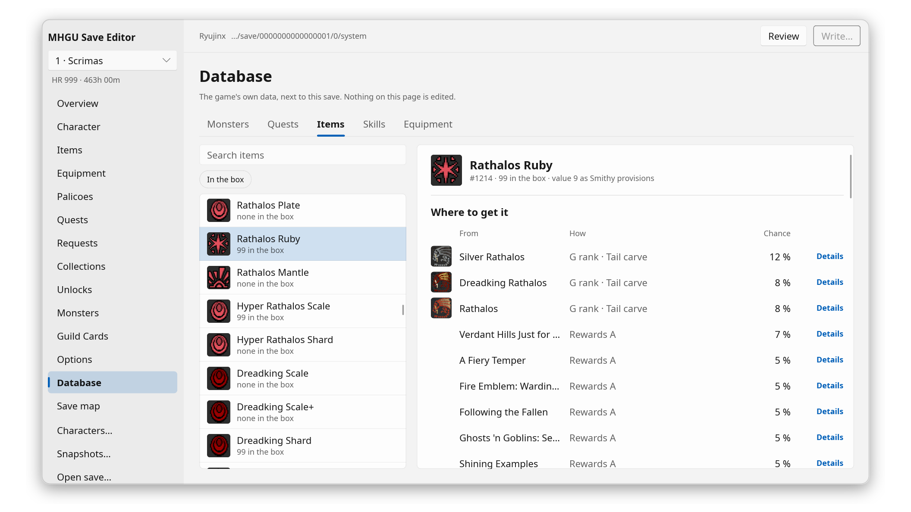</picture></a>
    </td>
    <td width="50%">
      <a href="docs/screenshots/README.md#database-skill"><picture><source media="(prefers-color-scheme: dark)" srcset="docs/screenshots/10-database-skill-dark.png">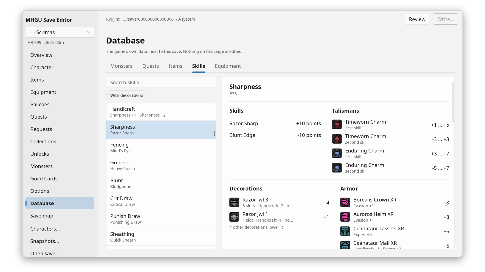</picture></a>
    </td>
  </tr>
  <tr>
    <td align="center">Items: where to get it</td>
    <td align="center">Skills: what gives the points</td>
  </tr>
</table>

## Keeping your save safe

- **Nothing is written until you press Write.** Review lists every change in game terms;
  each one can be undone.
- **Write refuses while the emulator is running** (it would overwrite the save when it
  exits), and **refuses a save the game saved again after you opened it**, so no play is
  lost; Reload reads it again and keeps your changes.
- **A snapshot is taken before every write.** **Snapshots** puts any of them back, and
  Compare shows what differs between two of them, in game terms.
- Every copy of the save the emulator keeps is written, and checked by reading it back.

Keep your own backup anyway. This is an unofficial tool.

<table>
  <tr>
    <td width="50%">
      <a href="docs/screenshots/README.md#write"><picture><source media="(prefers-color-scheme: dark)" srcset="docs/screenshots/06-write-dark.png">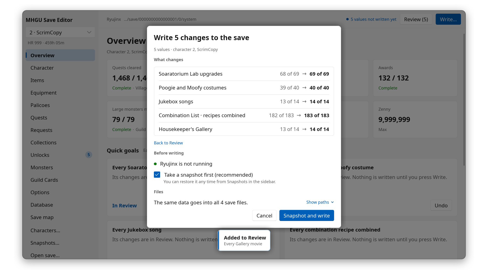</picture></a>
    </td>
    <td width="50%">
      <a href="docs/screenshots/README.md#snapshots"><picture><source media="(prefers-color-scheme: dark)" srcset="docs/screenshots/14-snapshots-dark.png">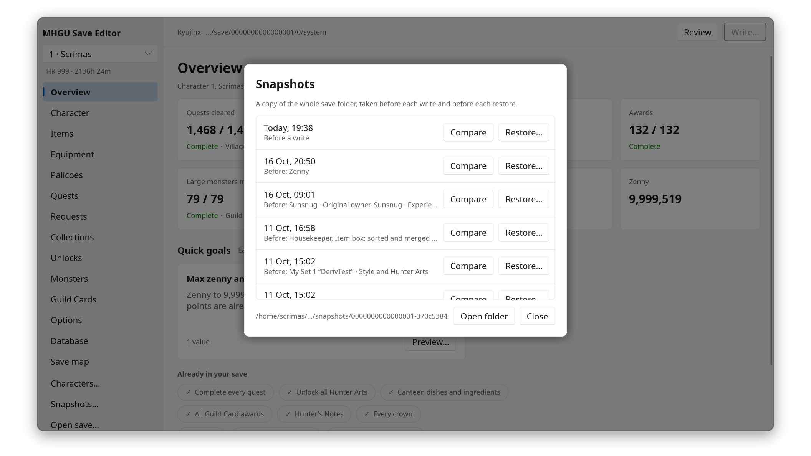</picture></a>
    </td>
  </tr>
  <tr>
    <td align="center">Write</td>
    <td align="center">Snapshots</td>
  </tr>
</table>

**Keyboard**: Ctrl+S write, Ctrl+Z undo, Ctrl+F search, Ctrl+O open, Ctrl+Up/Down change
page, Ctrl+Left/Right change tab, the arrows move between entries and Enter edits one,
Escape closes. The mouse's Back/Forward buttons go through the pages you saw.

## Settings

**Settings…** in the sidebar: language, theme and interface size; where snapshots go, how
many to keep and whether Write takes one; extra folders to search for saves; recent saves;
and **Confirmed changes only**, which refuses every Derived change.

The editor speaks the game's own languages: English, French, German, Italian, Spanish,
Traditional and Simplified Chinese (the system's by default), with item, equipment, skill
and monster names as the game writes them. On Linux it can follow your wallpaper's colours
with matugen ([setup](app/README.md#colours-from-matugen)).

<a href="docs/screenshots/README.md#settings"><picture><source media="(prefers-color-scheme: dark)" srcset="docs/screenshots/07-settings-dark.png">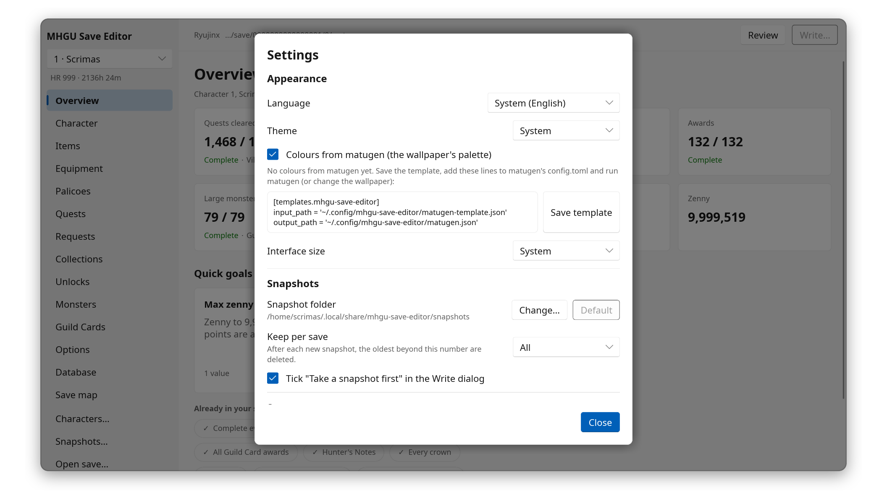</picture></a>

## How it works

The editor rests on notes about the save format, written up from controlled experiments
in game: [docs/](docs/README.md). Building from source and the repository layout:
[app/README.md](app/README.md). Bug reports, in-game checks and pull requests:
[CONTRIBUTING.md](CONTRIBUTING.md).

## Licence

Copyright © 2026 Scrimas. Free software under the GNU General Public License, version 3
or any later version ([`LICENSE`](LICENSE)), with no warranty. This covers the whole
repository: the editor, the tools, the notes and the data.

Monster Hunter and its assets are © CAPCOM. This is an unofficial fan project, not
affiliated with or endorsed by Capcom or Nintendo. The editor's UI toolkit,
[Slint](https://slint.dev), is used under its Royalty-free 2.0 licence.
